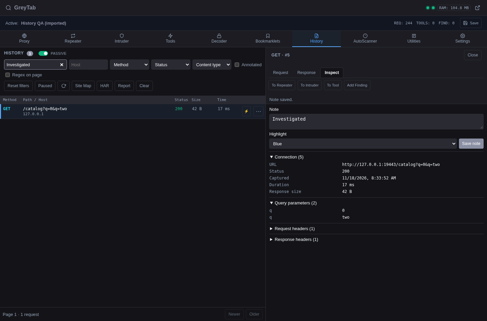
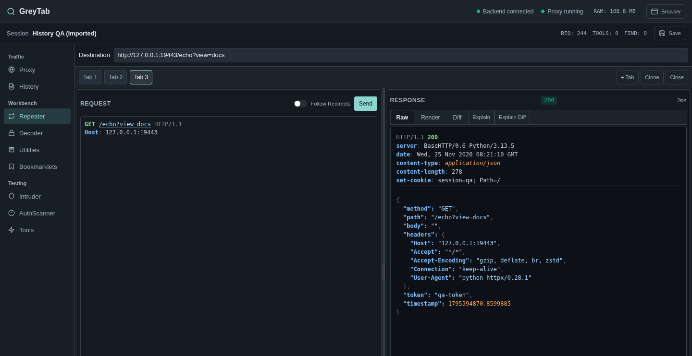
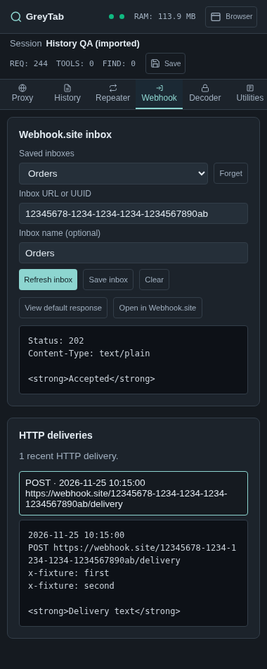
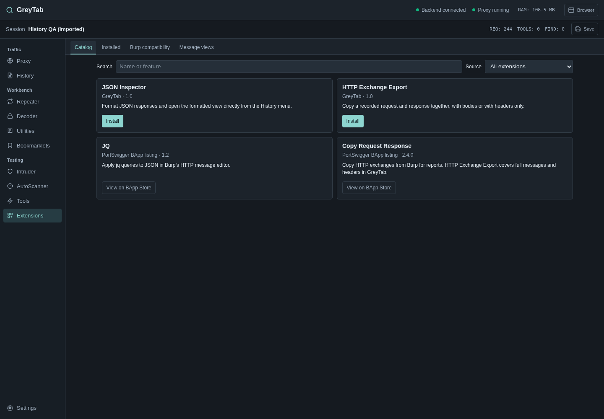
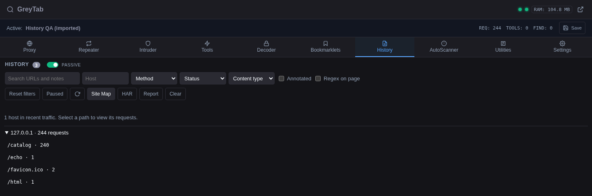
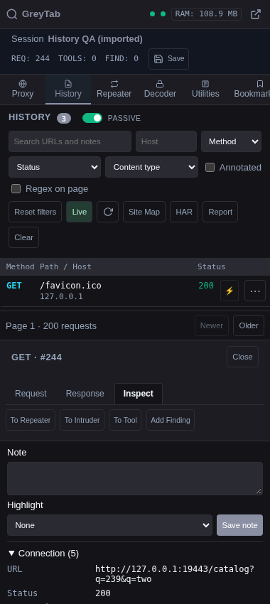

<div align="center">
  
  <h1>GreyTab</h1>
  <p>A Linux browser workspace for web security testing.</p>
</div>

GreyTab combines an intercepting HTTP/HTTPS proxy, request replay, fuzzing, scanning and external tools in a Chromium extension. Version **0.7.0** supports **Linux x86_64 and ARM64** and installs a dedicated **Chromium 156.0.8078.79** and **Python 3.13.18** for the host architecture.

## Install

```bash
curl -fsSL https://raw.githubusercontent.com/sPROFFEs/GreyTab/v0.7.0/quickstart.sh | bash
```

Launch **GreyTab** from your application menu, or run `~/.local/bin/greytab`. The workspace opens in a separate window alongside Chromium. Create or resume a session there, then choose **Browser** to return to browsing. Use `greytab --side-panel` to open GreyTab from the browser toolbar on demand. `greytab --check` checks the installation and `greytab --version` prints the version.

The desktop entry starts GreyTab without opening a terminal and writes launcher output to `logs/launcher.log`.

Use **Settings → Application updates** to check for GitHub releases and stage the verified update for the next launch. See [updating and recovery](docs/INSTALL.md#update-and-recovery).

The installer selects the matching release archive and verifies its SHA-256. It installs portable Chromium, uv, the pinned Python runtime and locked dependencies under `~/.local/share/greytab`, with a command in `~/.local/bin`. You need a graphical Linux session, glibc and Chromium's system libraries, Python 3.9+ for bootstrapping, `curl`, `tar` and `sha256sum`. See [installation and updates](docs/INSTALL.md) for supported architectures, distribution packages and troubleshooting.

## Workspace

| View | Available workflows |
| --- | --- |
| Proxy | Intercept, edit, forward and drop requests and responses; recover queued interceptions when reopening the panel. Turning interception off forwards pending messages. |
| History | Paged HTTP/HTTPS history with live pause, session-wide URL and note search, content filters, an exchange inspector, site map, HAR and findings reports. |
| Repeater | Independent tabs with preserved destinations, editable raw HTTP, redirect control, static response preview, consecutive-response diff and optional AI explanation. |
| Intruder | Sniper, Battering Ram, Pitchfork and Cluster Bomb; lists, numeric ranges and wordlists; concurrency control and grep extraction. |
| AutoScanner | Crawl or test a captured request; XSS, SQLi, traversal, LFI, redirects, SSTI, command injection, CRLF, SSRF, CORS and optional OAST; attempts, evidence and findings. |
| Webhook | Save free Webhook.site inboxes locally and read their HTTP deliveries and default responses. |
| Utilities | Concurrent request races, captured WebSocket frames, saved login macros and GraphQL introspection. |
| Decoder | Base64, URL, hex, HTML entities, Unicode, hashes, JWT decoding and HMAC signing. |
| Tools | Run installed tools or custom commands, upload wordlists, inspect output in a separate terminal and cancel processes. |
| Bookmarklets | Page inspection helpers including a reversible Smart Reveal, OSINT launchers and your own snippets. |
| Settings | Match & Replace rules, scoped token capture/injection, proxy configuration, custom tools and optional AI providers. |
| Extensions | Browse native view packs and selected BApp listings, inspect Burp archives, and add read-only views to History and Repeater. |

[Usage guide](docs/USAGE.md) explains these workflows, keyboard shortcuts and practical limits. Audit only targets for which you have authorization.

[Extension guide](docs/EXTENSIONS.md) covers the catalog, Burp compatibility report, native view packs and a sample manifest. [Platform notes](docs/PLATFORMS.md) cover Android feasibility.

## Screenshots

The captures below show GreyTab running against local test data in the pinned Chromium.

**History and Inspector** show recorded traffic, annotation filters, connection details and decoded parameters in one workspace.



<details>
<summary>See Repeater, Webhook, Extensions, Site Map and the narrow side panel</summary>

**Repeater** displays an editable HTTP request alongside its response, status and elapsed time.



**Webhook** shows saved inboxes, the configured default response and recent HTTP deliveries.



**Extensions** offers one-click installation of native view packs and links to selected BApp Store listings. Archive inspection and installed packs have their own views.



**Site Map** groups recorded paths by host. Select a path to jump to its requests in History.



**Narrow side panel** stacks History and Inspector so you can keep working alongside the target page.



</details>

## Projects and reports

Sessions, requests, WebSocket frames, findings, annotations and tool output are stored locally in SQLite. Saving a `.pbx` project includes up to 50,000 HTTP requests, 5,000 WebSocket frames, findings, tool runs and workspace state. Import creates a new session and remaps request references. Local session data survives upgrades. HAR exports and UI lists have explicit limits documented in the [usage guide](docs/USAGE.md#limits).

The workspace restores recent Repeater, Intruder and scanner state when reopened. Full persisted history stays in SQLite; browser storage contains a bounded recent snapshot.

## Development and validation

```bash
python3.13 -m venv .venv
.venv/bin/python -m pip install -r requirements.lock -r requirements-dev.txt
.venv/bin/pytest -q
python3 scripts/install_runtime.py
.venv/bin/python tests/browser_smoke.py
```

The browser suite loads the actual extension in the pinned Chromium and exercises local HTTP/HTTPS interception, all Intruder modes, replay, macros, WebSockets, exports, project import and responsive layouts. It creates screenshots and a JSON report under `tests/_runtime/browser/`.

- [Architecture and data](docs/ARCHITECTURE.md)
- [Testing and release checks](docs/TESTING.md)
- [Scanner lab regression](regression/README.md)
- [Release procedure](docs/RELEASE.md)
- [0.7.0 QA results and limitations](docs/QA-0.7.0.md)
- [Changes](CHANGELOG.md) · [Contributing](CONTRIBUTING.md) · [Security](SECURITY.md)

GreyTab covers several everyday Burp-style workflows. It does not claim Burp Suite feature parity or equivalent scanner accuracy; see the documented limits and test evidence.
